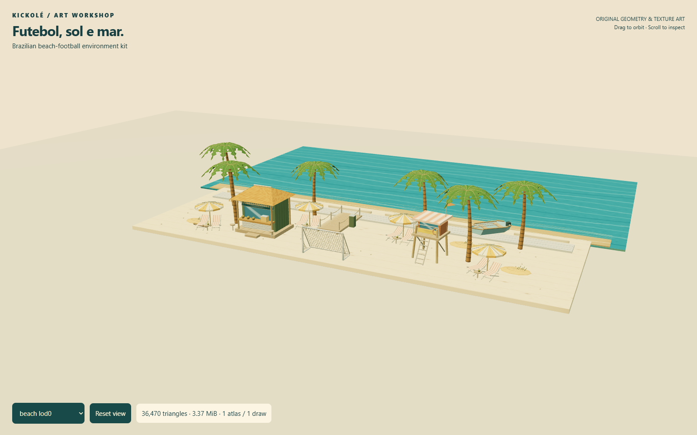
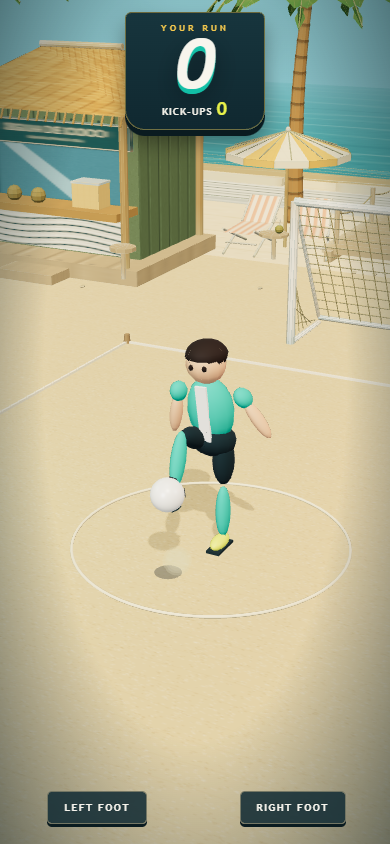
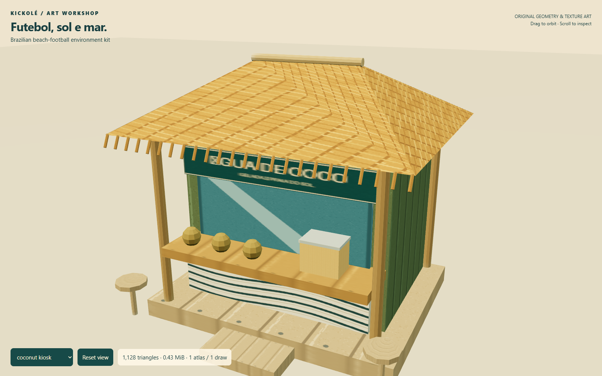

# Beach graphics validation — 19 October 2026

Local development and local production-build verification. No main merge/push or Cloudflare deployment is claimed.

## Assets and automated checks

- Ten beach GLBs passed Khronos `gltf-validator`: zero errors, warnings or informational messages. Manifest SHA-256 values matched.
- Same-environment repeat generation produced identical hashes for all ten beach GLBs (Python 3.12.14, Pillow 12.3.0).
- TypeScript, 76 tests across eight files, default street production build and explicitly enabled beach production build passed.
- All ten modules loaded in the orbit gallery using the actual Three.js GLTFLoader, decoded embedded PNGs and rendered their expected triangle counts. Two draws per gallery frame: model plus review floor.
- Mobile checks exercised Low/Medium/High at 320×568, 390×844 and 844×390, with the expected beach GLB returned HTTP 200, no page errors or overflow and no graphics error screen. Development and local production builds were exercised; production checks use real keyboard input without the development engine hook.
- Intentional GLB-request failure leaves a usable simple ocean/goal scene, court, player and controls. Expected model-load/error-boundary console logging occurs in this failure case.
- The expanded quality-switch check exposed a pre-existing listener problem: replacing a canvas could interpret disposal of its old GL context as failure of the current scene. The context-loss listener now lives inside the canvas and unsubscribes on unmount. Final focused checks passed for both street and beach: LOW / MEDIUM / HIGH / LOW switches work, and a deliberately lost **current** GL context still shows the recovery screen. The final beach production sweep includes these checks too.
- No changes to engine, controller, scoring, input, UI, ball/character/pose code, application dependencies, street GLB/PNG assets or hosting workflows.

Machine-readable results: [`beach-validation.json`](beach-validation.json). Scripts and reproduction steps are in `BRAZILIAN_BEACH.md`. Full generated screenshots/reports are in ignored `beach-shots/`.

## Visual review

Opened the assembled beach, palm cluster, kiosk, lifeguard tower, fishing boat, umbrella/lounger set and goal, plus High portrait/landscape and Low portrait gameplay screenshots. The goal, beach furnishings, shoreline and palms form the backdrop; player, ball and touch controls remain readable in those inspected captures. Some tall/side scenery is intentionally cropped by the fixed camera. Not every capture was individually inspected by eye.

Gallery lighting differs from game lighting/fog. Models are stylized procedural assets with a base-colour atlas and modeled detail, not scanned/photographic assets. Ocean/foam/foliage are static. The seven standalone modules are merged full-detail meshes, not individually articulated props, and do not have their own LOD files.

## Limits and release status

Original reference pictures were unavailable; matching them is unverified. Browser emulation uses headless Chromium and ANGLE/SwiftShader software rendering. No physical iPhone/Android testing, meaningful hardware frame-rate measurement, sustained thermal/GPU-memory check, cellular loading, complete accessibility regression or real safe-area verification was performed. Cached LODs consume memory after quality switching.

No hosted response headers, Cloudflare URL or deployment result was checked. The default production theme remains street; a beach release requires `VITE_ENVIRONMENT_THEME=beach` during the existing GitHub workflow's build, followed by deployed-site verification. See `CURSOR_BEACH_HANDOFF.md`.
