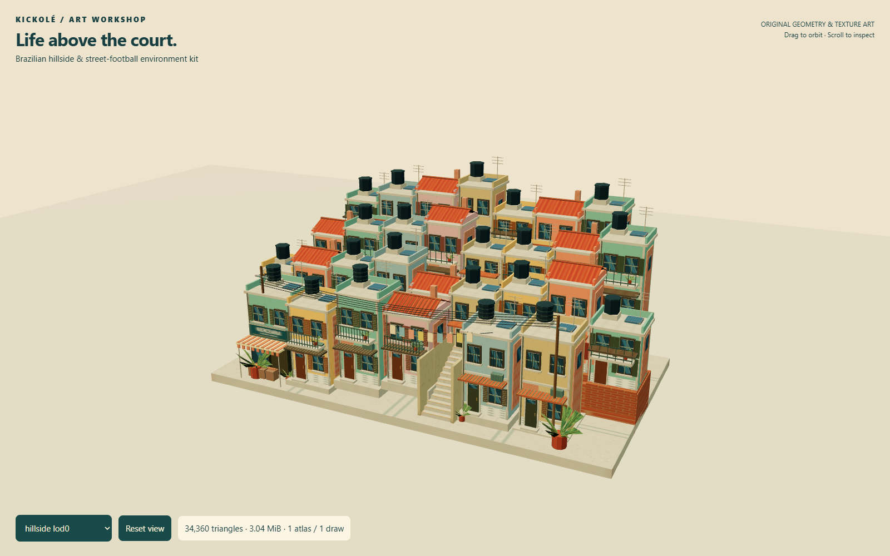
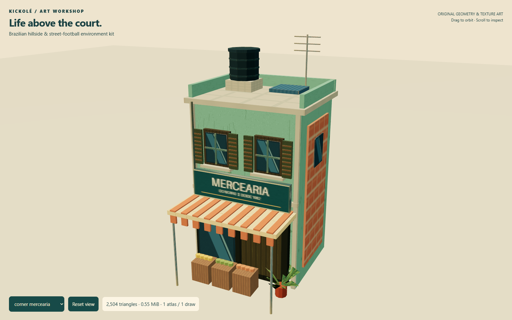
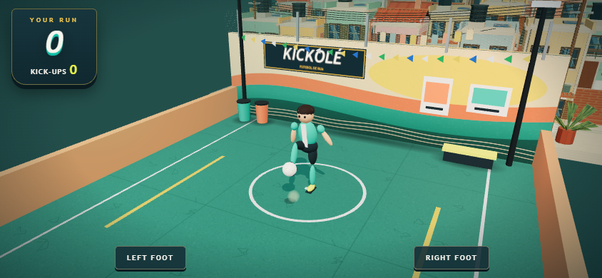

# Environment validation — 19 October 2026

Local review only. Main/Cloudflare were not changed by this graphics branch.

## Automated results

- `npm ci`: locked application dependencies installed; package files unchanged.
- `npm run typecheck`, `npm test`, `npm run build`: passed, 67 tests in seven files.
- Khronos `gltf-validator`: all ten final GLBs passed with zero errors, warnings or informational messages. SHA-256 values matched the manifest.
- Repeated generation using Python 3.12.14 and Pillow 12.3.0 produced identical hashes for all ten GLBs in the same environment. Font/Pillow version changes may change the atlas output.
- Browser gallery: all ten assets loaded with Three.js GLTFLoader, decoded the embedded PNG, rendered the expected triangles and exactly two draw calls (one model plus review floor), with no page errors.
- Game smoke checks: Low/Medium/High at 320×568, 390×844 and 844×390. Correct LOD returned HTTP 200, exactly one environment GLB requested on each fresh page, no page errors, no document overflow, no scene error screen, controls started a run and the canvas remained live.
- Model-request abort: original hillside fallback and playable canvas remained available. The intentional failed request emits the expected React/model-load error logging; that failure case is not described as error-free.
- Diff check: no whitespace errors. No changes to `src/engine`, `src/game`, `src/ui`, pose/character/ball logic, dependency manifests or GitHub workflows.

Machine-readable results: [`environment-validation.json`](environment-validation.json). Test scripts: `tools/validate-environment.mjs` and `tools/check-environment-browser.mjs`. Full captures are generated under ignored `environment-shots/`.

## Visual inspection

Opened and inspected the assembled high-detail hillside, grocery shop, stepped alley, rooftop kit and street furniture. Also inspected gameplay captures including High at 320×568 and 844×390, Medium at 390×844, and Low at 390×844. Player/ball and controls were visible; the sign/score did not overlap in those inspected gameplay captures. The buildings intentionally extend outside the fixed game camera; the complete asset is visible in the gallery. Not every screenshot was individually inspected by eye.

Review snapshots (software-rendered Chromium):

The gallery lighting differs from game lighting/fog. Close-up props use a single base-colour atlas and modeled details; they are stylized procedural assets, not photogrammetry. Finer lettering softens at oblique viewing angles.

## Not established

- Similarity to the original reference pictures: those pictures were unavailable.
- Frame rate or GPU/memory budgets on physical iOS/Android devices. Chromium used ANGLE/SwiftShader software rendering; screenshot timings do not establish performance.
- Sustained play, all animation transitions, full UI/accessibility regression, actual safe areas/notches, cellular load time, or graphics quality-switch memory after prolonged play.
- Hosted build, Cloudflare response headers, production deployment success or production smoke tests. Local build and browser checks are not hosted verification.

The merge/deploy prompt explicitly requires the remaining hosted checks after the existing Cloudflare workflow runs. The branch push is the delivered source/asset handoff, not a deployment claim.
