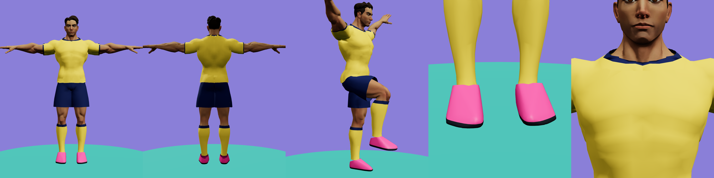

# Freddie character models (Quaternius CC0)

Branch `freddie/character-models` added `public/models/kickole_player_v2.glb`. The game now loads `public/models/kickole_player_v3.glb`, built from that file by `tools/build_player_v3.ts` so it matches `docs/CHARACTER_GLB.md` (contract bone names, screen-left `_L`, ≤40 bones, eight materials, <15k triangles, and the five clips). `kicky-player-rigged.glb` stays as the procedural contract reference. v2 itself has no clips; `src/scene/ue-pose.ts` still maps the procedural pose onto the UE bone names (sides swapped) and is what v3's clips and trick overlay use.

Licence: Quaternius Universal Base Characters [Standard], **CC0 1.0** (see `public/models/LICENSE.txt`).

## Differences from `docs/CHARACTER_GLB.md` contract (v1 and v2)
| Contract | This model | Fix needed |
|---|---|---|
| Bones `Hips, Spine, Head, UpperArm_L/R, UpperLeg_L/R, LowerLeg_L/R, Foot_L/R` | UE5-mannequin names: `pelvis, spine_01..03, Head, upperarm_l/r, thigh_l/r, calf_l/r, foot_l/r` (`Head` matches) | rename in Blender or add a name map in `rig.ts` |
| `_L` = world −X (screen/control side), facing +Z | model faces +Z; Quaternius `_l` is anatomical left = world **+X** → `upperarm_l` maps to contract `UpperArm_R` | swap sides when mapping |
| ≤ 40 bones, ≤ 2 influences/vertex preferred | 65 bones (fingers), up to 4 influences | delete finger/leaf bones + limit weights if required |
| Exactly 5 clips `Idle, KickLeft, KickRight, Miss, Celebrate` (30 fps, in place, contact 0.30 s) | **no clips** | author/retarget clips (see below); game falls back to procedural pose |
| Materials `Shirt, Shirt_Trim, Shorts, Socks, Boots, Boots_Sole, Skin, Hair` | v1: `Skin, Kit_Shirt, Kit_Shorts, Kit_Socks, Boots, Hair, Eyes`; v2: contract names + `Eyes` | v1 wrong names; v2 has one extra (`Eyes`, 9 total vs max 8) |
| Base colours neutral, overwritten at runtime | `Skin` and `Hair` use colour textures (runtime colour multiplies them) | tint skin via `color` near white only |
| < 15k tris, < 1.5 MB, textures ≤ 1024 | v1 15,619 tris / 375,864 B; v2 16,889 tris / 361,448 B; textures ≤ 1024 WebP | both slightly over the 15k tris |
| T/A-pose rest, feet at y=0, origin between feet, height 1.6–1.9 m | T-pose, feet y≈0, ~1.84 m | OK |
| Idle bbox width < 1 m | T-pose arm span ~1.86 m (no Idle clip yet) | resolved once an Idle clip lowers arms |
| Meshopt/Draco + KTX2/WebP | Meshopt + WebP (`EXT_meshopt_compression`, `EXT_texture_webp`) | the loader must set a Meshopt decoder |

## v2 – `public/models/kickole_player_v2.glb` (modelled kit) — recommended



| | |
|---|---|
| Size | 361,448 bytes (~353 KB) |
| Triangles | 16,889 (Body 8,066 · Shirt 2,148 · Boots 1,884 · Hair 1,301 · Eyebrows 984 · Shorts 904 · Socks 834 · Eyes 768) |
| Skeleton | one skin, same 65 UE-style bones as v1 (Blender round-trip verified: joint node transforms identical to the Quaternius original) |
| Materials | `Shirt` #FFD93D, `Shirt_Trim` #1E2A5A (collar, cuffs **and sock bands**), `Shorts` #1E2A5A, `Socks` #FFD93D, `Boots` #FF4F9A, `Boots_Sole` #222831, `Skin`, `Hair`, `Eyes` – kit materials are flat colour (no textures), roughness 0.5–0.85, metalness 0, double-sided |
| Textures | Skin 1024² base+normal WebP, Hair 512² base+normal WebP, Eyes 256² WebP |
| Compression | Meshopt (scene quantization volume) + WebP |

How it was built (`tools/freddie/blender_build_player_v2.py`, Blender 4.5.9 LTS headless, then `tools/freddie/post_player_v2.mjs`):
- Shirt / shorts / socks are copies of the body surface, cut with planes (clean hems: waist hem z=1.0 m, sleeves at |x|=0.36 m, crew neck lower at the front), decimated to 60 %, pushed out 6–25 mm along normals (shirt and shorts flare slightly at the hem). They keep the body's original skin weights.
- Boots: convex hull of each foot inflated by 13 mm, voxel-remeshed, smoothed, decimated, opening cut at the ankle, a sole band cut at 16 mm; weights by Data Transfer from the body (nearest-face interpolated).
- Body faces fully hidden under clothing (torso, thighs, calves, feet) were deleted, so no skin pokes through. Skin stays on the head, neck, forearms, hands, knees and the gap between socks and shorts.
- Rebuild: `blender -b --python tools/freddie/blender_build_player_v2.py` (paths at the top), then `node tools/freddie/post_player_v2.mjs raw.glb kickole_player_v2.glb`.

Known limitations: boots are a simple rounded "clog" shape (no studs or laces); collar trim edge is a little uneven; light faceting from decimation on the shirt; sock bands share `Shirt_Trim`, so recolouring the trim also changes the sock bands. The extra `Eyes` material makes 9 materials (contract max 8). 16.9k tris is over the contract's 15k (decimate the body or drop eyebrows to reach it).

## v1 – `public/models/kickole_player_v1.glb`

Source: Quaternius **Universal Base Characters [Standard]** – `Superhero_Male_FullBody` (Godot/UE glTF) + `Hair_SimpleParted` (rigged to head bone).
Licence (from `License_Standard.txt` in the pack): **CC0 1.0 Universal – Public Domain Dedication** (https://creativecommons.org/publicdomain/zero/1.0/). Commercial use OK, no attribution required (credit "Quaternius" is appreciated).

## File
| | |
|---|---|
| Size | 375,864 bytes (~367 KB) |
| Triangles | 15,619 total (body 12,566 · hair 1,301 · eyebrows 984 · eyes 768) |
| Compression | `EXT_meshopt_compression` + `KHR_mesh_quantization`, textures `EXT_texture_webp` |
| Textures | body base colour + normal 1024² WebP; hair base colour + normal 512² WebP; eyes 256² WebP. Roughness map dropped (constant roughness 0.75). |
| Units / up | metres, Y-up, ~1.84 m tall, feet at y≈0, **T-pose** bind pose, no animations included |
| Draw calls | 8 skinned primitives (body split into 5) |

## Skeleton
One skin, **65 bones, UE5-Mannequin naming** (NOT Mixamo): `root, pelvis, spine_01..03, neck_01, Head, clavicle_l/r, upperarm_l/r, lowerarm_l/r, hand_l/r, (index|middle|ring|pinky|thumb)_01..03 + _04_leaf, thigh_l/r, calf_l/r, foot_l/r, ball_l/r, ball_leaf_l/r`. Hair + eyebrows + eyes are all bound to this same skin (hair weights 100 % `Head`).

## Materials (all `MeshStandardMaterial` after load)
| name | use |
|---|---|
| `Skin` | original textured body (head, neck, forearms, hands) |
| `Kit_Shirt` | flat #FFD93D, body normal map @0.35 (torso + upper arms) |
| `Kit_Shorts` | flat #1E2A5A (pelvis + thighs) |
| `Kit_Socks` | flat #FFD93D (calves) |
| `Boots` | flat #FF4F9A (feet) |
| `Hair` | grey texture tinted dark brown via baseColorFactor (used by Hair + Eyebrows) |
| `Eyes` | eye texture |

The original body is a **single skin-suit material** (skin + dark briefs, no clothing). The kit materials were made by splitting the body triangles by dominant bone weight, so the kit is just recoloured body surface (no real shirt/boot geometry, feet still show toes) and seams are slightly jagged at waist/knees/ankles. Recolour kits at runtime by setting `material.color` on the `Kit_*` / `Boots` materials, or give them a `map` (kit texture painted on the body UVs, `TEXCOORD_0`). Better later: model a proper shirt/shorts/boots mesh in Blender bound to the same skeleton.

## Loading (R3F + drei)
```jsx
import { useGLTF, useAnimations } from '@react-three/drei'
import { useEffect, useRef } from 'react'

export function Player({ kit = '#FFD93D', shorts = '#1E2A5A', anim = 'idle', ...props }) {
  const group = useRef()
  const { scene, materials, animations } = useGLTF('/models/kickole_player_v1.glb') // drei wires the meshopt decoder by default
  const { actions } = useAnimations(animations, group)   // empty until clips are added
  useEffect(() => { materials.Kit_Shirt.color.set(kit); materials.Kit_Socks.color.set(kit); materials.Kit_Shorts.color.set(shorts) }, [kit, shorts])
  useEffect(() => { actions[anim]?.reset().fadeIn(0.15).play(); return () => actions[anim]?.fadeOut(0.15) }, [anim, actions])
  return <primitive ref={group} object={scene} {...props} />
}
useGLTF.preload('/models/kickole_player_v1.glb')
```
For multiple players use `SkeletonUtils.clone(scene)` (three/examples/jsm/utils/SkeletonUtils.js) and clone the kit materials per instance. Set `frustumCulled = false` on the skinned meshes if they pop out at screen edges.

## Animations – next steps
1. **Quaternius Universal Animation Library** (https://quaternius.com/packs/universalanimationlibrary.html, CC0) and **UAL 2** (https://quaternius.com/packs/universalanimationlibrary2.html, CC0) are made on the same "universal humanoid" UE-style rig as these characters, so clips should play on this skeleton directly by bone name. Useful for `idle` (Idle_Loop), celebrate (Dance_Loop / emotes), stumble/`miss` (Hit_* ), jogs/sprints. Neither has football kicks, juggling, foot stall or around-the-world.
2. Football clips from **Mixamo** (soccer kicks, juggling, victory) use `mixamorig:*` bones, so they must be **retargeted** to this UE skeleton: in Blender (import Mixamo FBX + this GLB, retarget with Rokoko/Auto-Rig Pro/"Mixamo→UE" bone map, bake actions) and export clips into this GLB, or at runtime with `SkeletonUtils.retargetClip` and a bone-name map (`mixamorigHips→pelvis`, `mixamorigSpine→spine_01`, `mixamorigLeftUpLeg→thigh_l`, …). Offline Blender baking is more reliable.
3. Name clips exactly: `idle, kick_l, kick_r, miss, celebrate, juggle, foot_stall, around_world`. `around_world` will likely need code-driven ball motion + a leg-circle clip.
4. Rebuild script: `tools/freddie/build_player_v1.mjs` (gltf-transform 4.5 + meshoptimizer + sharp).
