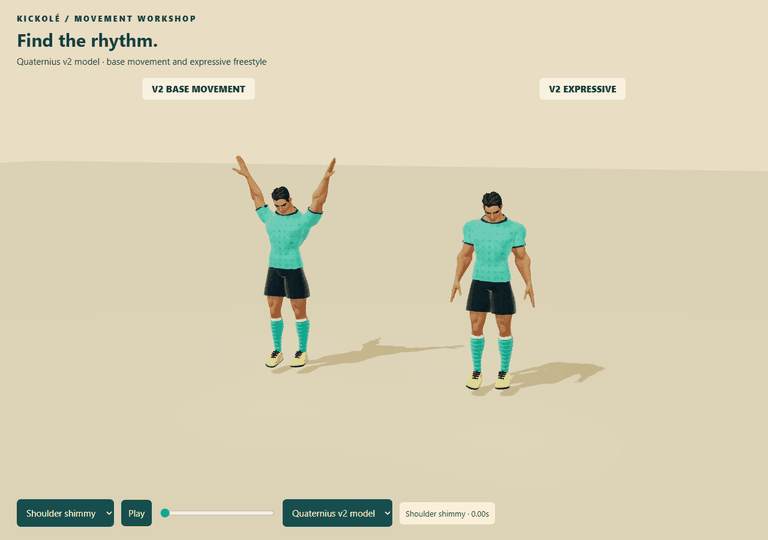
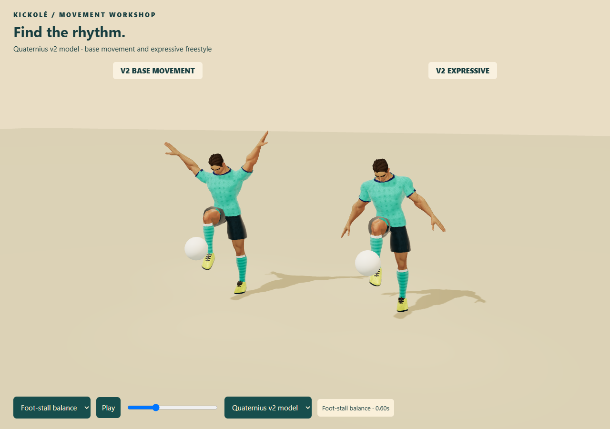

# Expressive player movement

Branch `graphics/expressive-player-movement` incorporates main `bfe489b`, including the newer Quaternius v2 model, its materials/lighting/laces, both environments and main's deployment configuration.

## Model and distinct movements

The default game and review model is `public/models/kickole_player_v2.glb`: 65 UE-style bones, 16,889 triangles, 361,448 bytes, Meshopt/WebP, no embedded animation clips. Its binary is unchanged from main. See `FREDDIE_CHARACTER_MODELS.md` for asset/licence details.

The original movement preview used the older five-clip reference character. Simply applying those accents to v2 also made celebrations look similar: they assumed an authored celebration clip that v2 does not have. `ue-motion.ts` now supplies complete arm poses in v2's local axes, retaining its rest-quaternion and arm-hang corrections. It gives the one-arm pump, shoulder shimmy and two-hand salute separate targets and an engine-clock envelope. These are runtime animation variations, not embedded clips or scoring tricks.

| Situation | Movement |
| --- | --- |
| Home / idle | Weight shift, breathing, shoulder sway, small ankle flex and head turns |
| Ready | Quicker bounce and counter-swinging arms |
| Ball in flight | Head tracks the ball, chest turns, arms anticipate descent |
| Foot touch | Three alternating upper-body styles: open-body turn, counter-turn, compact touch |
| Foot stall | Counterbalancing arms and chest/shoulder adjustment |
| Perfect response | One-arm pump, shoulder shimmy or two-hand salute |
| Drop / game over | Head shake and arm reaction, then settled recovery |

The primitive fallback and original contract-rig support remain. Gestures currently articulate shoulders, chest and head; elbows and fingers retain their rest pose, so the one-arm pump uses an open hand.

## Gameplay preservation

Motion reads simulation time and counters without changing the engine. Touch variants remain stable across the score increment. During live play, the extra root and foot movement is zero; v2 leg transforms are exactly the same as the base procedural pose at each sampled time. Upper-body bones sit outside the leg hierarchy. V2 retains main's small procedural stall flex rather than freezing its foot across time. The old clip rig restores base transforms before each additive update to avoid cumulative drift and uses engine time for paused samples.

No engine, controller, scoring, ball physics, input, gameplay UI, camera, court or workflow changes. The 0.04-second response and existing kick/stall simulation remain authoritative. This does not retune the newer model's existing boot-to-ball alignment or add movement around the court.

## Review

Run `npm run dev -- --host 127.0.0.1 --port 5189 --strictPort`, then open:

- `/tools/movement-preview.html`: v2 base movement on the left and expressive movement on the right; nine scenarios, pause/scrub and primitive fallback selection.
- `/?inspect&environment=beach`: actual engine kick/stall replay and contact inspector. Kick times retain the older clip scale; 0.30 means about 0.04 seconds after the tap.
- `/?environment=beach` or `/?environment=street`: actual game.

The comparison uses real character renderers. Selecting a movement restarts playback, including after pausing or scrubbing; it no longer leaves each new choice frozen at its neutral starting pose. Kick/stall examples replay the engine; idle/reaction examples stage engine values. The celebration ball is hidden in the viewer so the arm gesture is visible. The viewer is outside the production build and does not add a gameplay movement menu. Refresh an already-open preview to load the corrected v2 implementation.




## Verification

- Typecheck, 91 tests across 11 files, and a production beach build pass.
- Unit tests reconstruct the actual v2 node hierarchy and compare both boot world matrices against base procedural motion for left/right kicks and stalls at six times. They also distinguish the three complete v2 reaction poses. Existing engine, old clip-contract, motion restoration and deterministic sampling tests pass.
- Browser review selects all nine choices through the actual dropdown for v2 and primitive (18 captures). It verifies selection resumes playback from a paused frame, the v2 URL, UE rig, zero embedded clips, nine different rendered v2 joint signatures and identical base/expressive foot positions during live scenarios.
- Rendered engine inspector checks 12 left/right kick/stall samples, the trapped ball and upward release. This is not a claim of exact boot-to-ball surface alignment.
- Scripted repeated juggling checks street/beach at Low/High using normal engine inputs and fixed-step controller ticks, with actual v2 joint traces. This avoids software-GPU timing jitter; it is not a latency/performance measurement.
- Production smoke checks the local beach build at Low/High, portrait 390×844 and landscape 844×390, keyboard input, v2 asset loading and absence of page/graphics errors. Aborting the v2 request checks primitive fallback.

The refreshed record is `player-movement-validation.json`. Reproduce with:

```sh
npm run typecheck
npm test
npm run build
# Optional isolated playwright-core in .validation plus Chrome/Chromium:
node tools/check-movement-browser.mjs review
node tools/check-movement-browser.mjs contact
node tools/check-movement-browser.mjs game
# Set URL to a locally served production build:
node tools/check-movement-browser.mjs production
python tools/make-movement-preview.py
```

Outputs are ignored under `movement-shots/`; selected previews and the report are committed. The browser tool accepts `URL` and `CHROMIUM`. The GIF samples staged comparison frames, not real-time performance. Selected idle, touch, stall, all three celebration and actual game images were visually reviewed; not every saved image was inspected individually.

## Remaining limits

Headless Chromium uses SwiftShader software rendering. Physical-device smoothness, sustained GPU/battery/thermal behaviour, real-time touch latency and hosted deployment remain unverified. Existing v2 surface/contact alignment has not been retargeted or tuned. Merge/deploy instructions preserve the newer model and current theme in `CURSOR_MOVEMENT_HANDOFF.md`.
